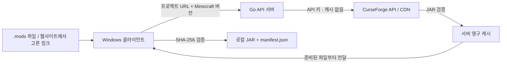

# cfmodsync — 캐시 서버와 Windows 클라이언트

[English README](README.md)

**Go 캐시 서버**와 **CurseForge 웹뷰를 내장한 C# WinForms 클라이언트**로 구성되어 있습니다. CurseForge API 키는 서버에 설정합니다. 클라이언트는 프로젝트 URL을 전달하고, 서버에서 검증된 JAR 파일을 받습니다.



## 서버·클라이언트 빠른 시작

서버를 소스로 빌드하려면 Go 1.27.3 이상이 필요합니다. 빌드된 서버 실행 파일을 사용해도 됩니다. 클라이언트 빌드에는 Windows와 .NET 10 SDK가 필요하며, 실행에는 [.NET 10 Desktop Runtime](https://dotnet.microsoft.com/ko-kr/download/dotnet/10.0)과 [Microsoft Edge WebView2 Runtime](https://developer.microsoft.com/microsoft-edge/webview2/)이 필요합니다.

1. **서버**에서 `.env`를 만들고 `CURSEFORGE_API_KEY`를 설정합니다.

   ```powershell
   Copy-Item .env.example .env
   notepad .env
   go run . serve
   ```

   기본 주소는 `http://127.0.0.1:8080`, 캐시 경로는 `cache/`입니다. 모드 목록은 클라이언트에서 전달하므로 서버에 `.mods` 파일을 둘 필요는 없습니다.

2. 저장소 루트에서 두 구성요소를 빌드합니다.

   ```powershell
   .\scripts\build.ps1
   .\artifacts\client\CfModSync.Client.exe
   ```

   빌드 스크립트는 서버·클라이언트를 빌드하고 테스트한 뒤 `artifacts/cfmodsync-windows.zip`을 만듭니다. 모의 CurseForge 서비스를 사용하는 Go 서버에 실제 C# 클라이언트를 연결하는 통합 검사도 포함됩니다. 지원되는 C 컴파일러가 설치된 환경에서는 `-Race` 옵션으로 Go 경쟁 상태 검사도 실행할 수 있습니다.

3. 클라이언트에서 서버 주소와 필요한 경우 **서버 접속 토큰**을 입력하고 **연결 확인**을 누릅니다. Minecraft 버전, 배포 채널, 의존성 포함 여부, 저장 폴더를 선택합니다.
4. **목록 가져오기**로 `.mods` 또는 `.mods.example`을 불러오거나 프로젝트 URL을 붙여 넣습니다. 웹뷰의 **모드 링크를 클릭하면 목록에 담기**를 켜면 모드 프로젝트 링크를 클릭해 목록에 추가할 수 있습니다. 프로젝트 페이지를 탐색하려면 이 옵션을 끄고, 원하는 페이지에서 **현재 프로젝트 담기**를 누르세요.
5. **선택한 모드 다운로드**를 누릅니다. 서버에서 다른 파일의 캐시를 채우는 동안에도 준비된 파일부터 받습니다. 기존 로컬 파일은 SHA-256 검증 후 재사용하며, 저장 폴더에 `manifest.json`을 기록합니다.

선택한 모드와 접속 설정은 `%LOCALAPPDATA%\cfmodsync\settings.json`에 저장합니다. 접속 토큰은 현재 실행 중인 세션에만 유지합니다. WebView2 데이터는 설정 파일 옆에 저장합니다. `CfModSync.Client.exe "C:\경로\.mods"`로 목록 파일을 바로 열 수도 있습니다.

### 서버 배포와 인증

배포 파일은 `server/`와 `client/` 폴더로 나뉩니다. 서버 컴퓨터에서 `server/.env.example`을 `server/.env`로 복사하고 API 키를 설정한 뒤, 해당 폴더에서 `Start-Server.ps1` 또는 `cfmodsync.exe serve`를 실행합니다. Windows 사용자에게는 `client/` 폴더 전체를 전달합니다. 서버의 `.env`는 배포에 포함하지 마세요.

| 서버 옵션 | 기본값 | 설명 |
| --- | --- | --- |
| `-listen` / `SERVER_LISTEN` | `127.0.0.1:8080` | 수신 주소 |
| `-cache` / `SERVER_CACHE_DIR` | `cache` | 영구 캐시 폴더 |
| `-token` / `SERVER_TOKEN` | 루프백에서는 빈 값 | CurseForge 키와 별개인 클라이언트 접속 토큰 |
| `-workers` | `4` | 서버 전체의 동시 원본 다운로드 수, 1~16 |
| `-max-file-mb` | `1024` | JAR당 최대 크기, MiB |
| `-metadata-ttl` | `15m` | 최신 파일 선택 결과를 재사용할 시간 |
| `-job-ttl` | `1h` | 완료된 작업을 메모리에 유지할 시간 |
| `-tls-cert` / `-tls-key` | 빈 값 | HTTPS 인증서와 개인 키 PEM 파일 |

루프백 외부 주소에서 수신하려면 32자 이상의 `SERVER_TOKEN`이 필요합니다. 서버 환경변수나 `.env`에 설정하세요. 원격 클라이언트 연결에는 `-tls-cert`·`-tls-key` 또는 HTTPS 역방향 프록시를 사용합니다. 클라이언트는 루프백 주소에만 일반 HTTP를 허용합니다. 접속 토큰은 `Authorization: Bearer ...` 헤더로 전달합니다. 서버 API는 웹사이트에서 발생한 Origin 요청을 거부하며, CurseForge API 키와 원본 다운로드 URL을 클라이언트에 제공하지 않습니다.

### 캐시 동작과 API

- JAR과 검증 정보는 `cache/files/<모드 ID>/<파일 ID>/`에, 최신 파일 선택 결과는 `cache/selections/`에 저장합니다. 서버를 재시작해도 유지됩니다.
- 선택 결과가 유효기간 안에 있고 JAR이 정상이라면 원본 API·CDN 요청 없이 전달합니다. **최신 목록 다시 확인**으로 선택 결과를 갱신할 수 있습니다. 기본 15분이 지나면 다음 요청에서 더 최신의 호환 파일을 확인합니다.
- 같은 파일의 동시 요청은 원본 다운로드 한 건을 공유합니다. 한 작업을 취소해도 다른 클라이언트가 필요한 공유 캐시 다운로드는 중단하지 않습니다.
- 임시 파일 다운로드 후 API의 SHA-1/MD5와 ZIP/CRC를 검증합니다. 캐시도 전달 전에 재검증하며, 손상된 캐시는 다음 작업에서 복구합니다.
- 작업 진행률, 파일별 오류, 취소를 지원합니다. 동시 작업은 8개, 보관 작업은 최대 128개입니다. 새 작업을 받을 때 `-job-ttl`이 지난 완료 기록을 정리합니다. 작업 ID는 재시작 시 사라지지만 목록을 다시 요청하면 영구 캐시를 재사용합니다.
- 현재 버전은 오래된 서버 캐시나 클라이언트 저장 폴더의 이전 JAR을 자동 삭제하지 않습니다. 디스크 여유를 확인하고 Minecraft 버전별 저장 폴더를 사용하세요. 지원 로더는 Minecraft **Forge**입니다.

| 메서드 | 경로 | 설명 |
| --- | --- | --- |
| `GET` | `/healthz` | 공개 상태 확인 |
| `GET` | `/api/v1/status` | 인증 및 프로토콜 연결 확인 |
| `POST` | `/api/v1/jobs` | 작업 생성, `202`와 작업 ID 반환 |
| `GET` | `/api/v1/jobs/{id}` | 진행률과 준비된 파일 경로 조회 |
| `DELETE` | `/api/v1/jobs/{id}` | 작업 취소 |
| `GET` | `/api/v1/files/{modId}/{fileId}` | 검증된 캐시 JAR 전달, HTTP Range 지원 |

작업 요청 본문 예시입니다. 프로젝트 URL은 프로젝트 루트 주소여야 합니다.

```json
{
  "project_urls": ["https://www.curseforge.com/minecraft/mc-mods/jei"],
  "minecraft_version": "1.20.1",
  "release_channel": "release",
  "include_dependencies": true,
  "refresh": false
}
```

작업 상태는 `queued`, `resolving`, `caching`, `completed`, `failed`, `cancelled`입니다. 준비된 파일에는 상대 경로인 `download_path`와 `verified.sha256`·`verified.size_bytes`가 포함됩니다. 일부 프로젝트가 실패해도 준비된 다른 파일을 받을 수 있습니다. 파일 선택 전에 배포 허용 여부를 검사하며, 캐시된 선택 결과는 메타데이터 유효기간까지 재사용합니다.

## 단독 CLI 사용

`.mods`에 CurseForge Minecraft **모드 프로젝트 URL**을 한 줄씩 넣으면, 프로젝트를 검색해 **Minecraft 버전 + Forge 로더**에 맞는 가장 최근 등록된 JAR를 다운로드합니다.

- 기본 환경: **Minecraft 1.20.1 / Forge**. `.env`의 `MC_VERSION`이나 `-version`으로 변경할 수 있습니다.
- 공식 [CurseForge Core API](https://docs.curseforge.com/rest-api/)를 사용합니다. 웹 HTML 스크래핑, `/download/latest` 리다이렉트 추측, URL·파일 ID 하드코딩은 사용하지 않습니다.
- 서버 API에서 `gameVersion`, `modLoaderType=1`을 필터링하고 결과의 버전/로더 표시를 재확인합니다. 정렬 기준은 **파일 등록 시각(FileDate)**이며, 게임 실행 호환성 자체를 보증하지는 않습니다.
- 필수 의존성(CurseForge의 `relationType=3`)은 기본적으로 재귀적으로 검색해 추가합니다. 다른 관계는 자동 추가하지 않습니다.
- 다운로드 검증: HTTPS, 안전한 파일명, 파일 길이, CurseForge가 제공한 **SHA-1/MD5** 체크섬, JAR/ZIP 내부 파일 CRC·압축 해제 검사. 로컬 SHA-256을 매니페스트에 기록합니다.
- 체크섬이 제공되지 않는 파일은 *검증 불가능*으로 보고 기본적으로 거부합니다. 해시와 ZIP 검사 통과가 곧 악성코드 검사나 Minecraft 부팅 성공을 뜻하지는 않습니다.
- 이미 다운받은 같은 파일은 재검증 후 `cached`로 재사용하며, 손상된 기존 파일은 자동 덮어쓰지 않습니다(`-force`로 재다운로드 가능).
- `manifest.json` 기록, `-dry-run` 계획 확인, `-verify-only` 오프라인 무결성 재검증, `-prune` 이전 실행에서 관리하던 오래된 버전 파일 정리.

## 1. API 키 필요

**2026년 7월 16일부터 CurseForge CDN 직접 다운로드에는 API 키가 필요합니다.** CurseForge REST API 검색도 `x-api-key` 인증을 요구합니다. 공식 정책 및 가이드:

- [CurseForge: CDN API key authentication](https://blog.curseforge.com/introducing-api-key-authentication-for-curseforge-file-downloads/)
- [API key 신청 절차](https://support.curseforge.com/support/solutions/articles/9000208346-about-the-curseforge-api-and-how-to-apply-for-a-key)
- [API 문서](https://docs.curseforge.com/rest-api/)

승인된 API 키를 직접 준비해야 합니다. 이 예제는 타인의 키를 제공하지 않으며 비공식 우회 API를 사용하지 않습니다. 프로젝트 소유자가 **third-party distribution**을 차단하면 API에서 파일을 제공하지 않을 수 있으며, 이 프로그램은 해당 설정을 우회하지 않습니다.

## 2. 설치 및 사용 (Windows PowerShell)

프로젝트 파일이 있는 폴더에서 실행합니다. Go 1.27.3 이상이 설치되어 있으면 소스로 실행할 수 있습니다. Windows `.exe` 빌드 파일도 별도 제공됩니다.

```powershell
Copy-Item .env.example .env
if (!(Test-Path .mods)) { Copy-Item .mods.example .mods }
notepad .env      # CURSEFORGE_API_KEY=... 입력
notepad .mods     # 다운로드할 프로젝트 URL 목록 편집

go run . -dry-run          # API에서 호환되는 최신 릴리스만 선택하고 plan.json 출력
go run .                   # JAR 자동 다운로드 + 검증
go run . -verify-only      # 저장된 manifest.json의 파일 오프라인 재검증
go run . -force            # 기존 동일 파일을 안전하게 재다운로드
```

소스 대신 바이너리 사용 시 `go run .`을 `./cfmodsync.exe`로 교체합니다.

설정 예시(`.env`):

```dotenv
CURSEFORGE_API_KEY=YOUR_APPROVED_KEY
MC_VERSION=1.20.1
RELEASE_CHANNEL=all
MOD_LIST=.mods
AUTO_DEPS=true
```

`OUTPUT_DIR`를 생략하면 `downloads/1.20.1-forge/`처럼 **MC 버전별로 분리**합니다. 1.21.1로 변경하면 기본 폴더도 `downloads/1.21.1-forge/`로 변합니다.

입력(`.mods`) 예시:

```text
# 한 줄에 하나. 프로젝트 URL 이외의 download/latest, /files/123 등을 쓰지 않습니다.
https://www.curseforge.com/minecraft/mc-mods/create
https://www.curseforge.com/minecraft/mc-mods/jei
```

`.mods.example`에는 예제 프로젝트 세 개가 들어 있습니다. `.mods`로 복사해 원하는 프로젝트를 남기거나 기존 목록을 사용하세요. `.mods`는 로컬 파일이며 Git에서 제외됩니다.

## 3. 명령줄 옵션

| 옵션 | 설명 |
| --- | --- |
| `-version 1.21.1` | `.env` 대신 특정 Minecraft 버전 선택 |
| `-input .mods.example` | 프로젝트 URL 목록 파일 변경 |
| `-output ./my-mods` | JAR 출력 폴더 변경 |
| `-channel release` | 안정 릴리스만 선택 (`beta`: release+beta, `all`: alpha 포함) |
| `-deps=false` | CurseForge 필수 의존성 자동 추가 해제 |
| `-workers 4` | 동시 다운로드 개수 (1~16) |
| `-max-file-mb 1024` | JAR당 최대 다운로드 크기 MiB |
| `-dry-run` | API 조회 후 다운로드 없이 `plan.json` 출력 |
| `-verify-only` | 인터넷/API 키 없이 `manifest.json` 기준 파일 재검증 |
| `-force` | 같은 이름의 기존 파일을 새로 받아 검증 후 교체 |
| `-prune` | 성공한 실행 이후 **이전 매니페스트에서 관리되던** 불필요한 JAR만 검증하고 삭제 |

`-prune`은 완전히 성공한 다운로드의 마지막 단계에서만 실행됩니다. `.minecraft/mods` 폴더에서 직접 실행하는 것을 권장하지 않습니다. 먼저 별도의 출력 폴더에서 다운로드·검증한 뒤 필요한 파일을 복사하십시오.

## 4. 선택·검증 규칙

1. 사용자가 제공한 URL 호스트와 경로를 검사하며 정확한 `slug`만 추출합니다.
2. CurseForge `GET /v1/mods/search?gameId=432&classId=6&slug=...`에서 정확한 프로젝트 ID를 확인합니다.
3. `GET /v1/mods/{modId}/files?gameVersion=<MC_VERSION>&modLoaderType=1`를 **페이지 끝까지** 조회합니다.
4. `isAvailable`, 게임 버전 일치, `.jar`, Forge 여부, 서버팩·소스팩·미공개 파일 제외 등을 검사합니다. 로더 태그가 완전히 없는 파일은 서버의 Forge 필터링 결과를 신뢰합니다.
5. 허용된 릴리스 채널의 후보 중 `FileDate`가 가장 최근인 파일을 선택합니다. 등록 시점이 같으면 File ID로 순서를 결정합니다.
6. `GET /v1/mods/{modId}/files/{fileId}/download-url`의 **실제 API 다운로드 URL**을 사용합니다. 프로젝트 페이지의 `/download/latest`는 사용하지 않습니다.
7. 다운로드는 `.partial` 임시 파일로 수행합니다. 크기·SHA-1/MD5·ZIP/CRC 검증 뒤에만 `.jar`로 이동시킵니다. CDN 인증은 `x-api-key` 헤더를 사용하고 타 도메인으로 리다이렉트될 경우 해당 헤더를 제거합니다.
8. 실패 항목은 `manifest.json`의 `errors`에 기록하고 계속 진행합니다. 실행 종료 코드는 실패가 하나라도 있으면 `1`입니다.

## 5. 한계 및 주의사항

- **실제 다운로드에는 승인된 유효 API 키가 필요합니다.** 자동화 테스트는 로컬 모의 HTTP/TLS 서버를 사용하며, C# 클라이언트와 Go 서버 간 실제 파일 전송도 검사합니다. 실제 API·CDN 접근은 설정한 키와 프로젝트별 배포 허용 여부에 따라 결정됩니다.
- 태그 호환성은 API 게시자가 제공한 메타데이터에 의존하며, `mods.toml` 안의 Forge 최소 버전·다른 모드의 버전 범위·충돌 여부까지 자동으로 해결하지는 않습니다.
- **차량 콘텐츠 팩과 번들 프로젝트**는 같은 CurseForge 프로젝트에서 최신 버전의 팩 계열 자체가 바뀔 수 있습니다. 예: Blue Seoul Vehicles에서 Garam → Narae 계열. 프로젝트 전체의 `1.20.1/Forge 최신`이 설치했던 팩의 후계 버전임을 보장하지 않습니다. 필요한 경우 특정 파일을 수동으로 고정하세요.
- `RELEASE_CHANNEL=all`은 alpha/beta까지 포함하므로 실제 플레이용은 필요에 따라 `beta` 또는 `release`로 제한하는 편이 안전합니다. 다만 snapshot/alpha만 배포하는 프로젝트는 선택되지 않을 수 있습니다.
- `-prune` 없이 업데이트하면 같은 모드의 오래된 JAR가 출력 폴더에 남을 수 있습니다. 이미 Minecraft mods 폴더인 곳에 직접 다운로드하는 것은 권장하지 않습니다.
- Forge와 NeoForge는 같은 것이 아니며, `MC_VERSION` 변경은 **Forge의 Minecraft 대상 버전만** 변경합니다. NeoForge로 자동 전환하지 않습니다.

## 6. 개발 및 테스트

표준 라이브러리만 사용합니다(외부 Go 모듈 없음).

```bash
go test -race ./...
go vet ./...
go build -o cfmodsync .
```

테스트 항목: URL 파싱, 최신 파일 선택, Minecraft 버전/로더 배제, 배포 채널, SHA-1 무결성, ZIP CRC, API 모의 서버 통합 다운로드, 필수 의존성 추가, 재실행 캐시 및 손상 파일 복구, 인증 헤더의 크로스 도메인 리다이렉트 차단.

Go 경쟁 상태 검사에는 CGO와 지원되는 C 컴파일러가 필요합니다. 해당 환경이 없으면 `go test ./...`를 사용하세요. `scripts/build.ps1`은 서버 캐시·인증·동시 요청 검사와 C# 다운로드 통합 검사도 실행합니다. Windows 클라이언트만 빌드하려면 `dotnet build client/CfModSync.Client/CfModSync.Client.csproj -c Release`를 사용합니다.
