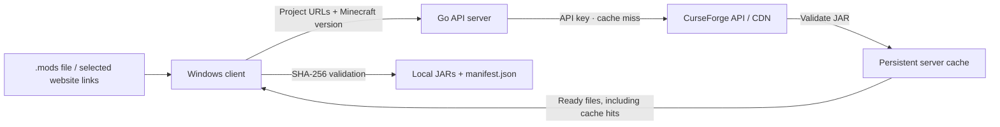

# cfmodsync — Cache Server and Windows Client

[Korean README](README.kr.md)

The project includes a **Go cache server** and a **C# WinForms client with an embedded CurseForge WebView2 browser**. The server owns the CurseForge API key. Clients submit project URLs and receive verified JARs from the server.



## Server and client quick start

Server requirements: Go 1.27.3+ when building from source, or the compiled server executable. Client build requirements: Windows and the .NET 10 SDK. Running the client requires the [.NET 10 Desktop Runtime](https://dotnet.microsoft.com/en-us/download/dotnet/10.0) and [Microsoft Edge WebView2 Runtime](https://developer.microsoft.com/en-us/microsoft-edge/webview2/).

1. On the **server**, create `.env` and set `CURSEFORGE_API_KEY`:

   ```powershell
   Copy-Item .env.example .env
   notepad .env
   go run . serve
   ```

   The default address is `http://127.0.0.1:8080` and the cache directory is `cache/`. The server does not need a local `.mods` file; project lists come from clients.

2. Build both components from the repository root:

   ```powershell
   .\scripts\build.ps1
   .\artifacts\client\CfModSync.Client.exe
   ```

   The script builds and tests both components, runs a real C# client against a Go server backed by a mock CurseForge service, and creates `artifacts/cfmodsync-windows.zip`. `-Race` additionally enables Go's race detector when a supported C compiler is installed.

3. In the client, enter the server address and optional **server access token**, then click **Connect**. Select the Minecraft version, release channel, dependencies, and output directory.
4. Use **Import list** to import `.mods` or `.mods.example`, paste a project URL, or browse CurseForge. With **Add mod links when clicked** enabled, clicking a mod project link adds it to the basket. Disable this option to browse project pages, then use **Add current project** to add the current project.
5. Click **Download selected mods**. Ready files are transferred while the server fills other cache entries. Existing local files are reused only after SHA-256 validation. The client writes `manifest.json` in the output directory.

The basket and connection settings are saved in `%LOCALAPPDATA%\cfmodsync\settings.json`. The access token is kept only for the current session. WebView2 data is stored beside the settings. You can also open a list directly with `CfModSync.Client.exe "C:\path\.mods"`.

### Server deployment and authentication

The distribution contains separate `server/` and `client/` directories. On the server machine, copy `server/.env.example` to `server/.env`, configure the key, and run `Start-Server.ps1` or `cfmodsync.exe serve` from that directory. Distribute the entire `client/` directory to Windows users. Never distribute the server's `.env`.

| Server option | Default | Purpose |
| --- | --- | --- |
| `-listen` / `SERVER_LISTEN` | `127.0.0.1:8080` | Listen address |
| `-cache` / `SERVER_CACHE_DIR` | `cache` | Persistent cache root |
| `-token` / `SERVER_TOKEN` | Empty on loopback | Client bearer token, separate from the CurseForge key |
| `-workers` | `4` | Global upstream download concurrency, 1–16 |
| `-max-file-mb` | `1024` | Maximum JAR size in MiB |
| `-metadata-ttl` | `15m` | How long to reuse latest-file selections |
| `-job-ttl` | `1h` | Completed job retention in memory |
| `-tls-cert` / `-tls-key` | Empty | Optional HTTPS certificate and private key PEM files |

Listening outside loopback requires a `SERVER_TOKEN` of at least 32 characters. Set it in the server environment or `.env`. Use HTTPS for remote clients, either with `-tls-cert` and `-tls-key` or an HTTPS reverse proxy; the desktop client accepts plain HTTP only for loopback addresses. The client sends the token in the `Authorization: Bearer ...` header. The API rejects browser-origin requests and does not expose the CurseForge key or upstream download URLs.

### Cache behavior and API

- JARs and their verification metadata live in `cache/files/<mod-id>/<file-id>/`. Latest-file selections live in `cache/selections/`. Both survive server restarts.
- An unexpired selection cache and valid JARs need no upstream API or CDN requests. A client can force a metadata refresh with **Refresh latest files**. After the metadata TTL expires, the server checks CurseForge for newer compatible files.
- Concurrent requests for the same file share one upstream download. Cancelling one job does not cancel a shared cache fill needed by another client.
- Cache fills use temporary files, API SHA-1/MD5 checksums, and ZIP/CRC validation. Cached files are revalidated before delivery; damaged cache entries are repaired on the next job.
- Jobs support progress, per-file errors, and cancellation. The server allows eight active jobs and retains at most 128 jobs; completed records expire after `-job-ttl` when new jobs arrive. Job IDs do not survive restarts; resubmit the list to reuse persistent files.
- This version does not automatically evict old server cache files or remove older JARs from client output folders. Monitor available disk space and keep Minecraft versions in separate output directories. It supports Minecraft **Forge**.

| Method | Route | Purpose |
| --- | --- | --- |
| `GET` | `/healthz` | Public health check |
| `GET` | `/api/v1/status` | Authenticated protocol/connection check |
| `POST` | `/api/v1/jobs` | Create a job; returns `202` and a job ID |
| `GET` | `/api/v1/jobs/{id}` | Poll progress and ready-file download paths |
| `DELETE` | `/api/v1/jobs/{id}` | Cancel a job |
| `GET` | `/api/v1/files/{modId}/{fileId}` | Receive a validated cached JAR; supports HTTP Range |

Example job body (project URLs must be canonical project URLs):

```json
{
  "project_urls": ["https://www.curseforge.com/minecraft/mc-mods/jei"],
  "minecraft_version": "1.20.1",
  "release_channel": "release",
  "include_dependencies": true,
  "refresh": false
}
```

Job states are `queued`, `resolving`, `caching`, `completed`, `failed`, and `cancelled`. Each ready file includes a relative `download_path` and `verified.sha256` / `verified.size_bytes`. A job may fail for some projects while still providing ready files for others. API distribution restrictions are checked before selecting files; a locally cached selection remains valid until its metadata TTL expires.

## Standalone CLI

Add one CurseForge Minecraft **mod project URL** per line to `.mods`. The tool searches each project and downloads the most recently listed JAR that matches the **Minecraft version and Forge loader**.

- Default target: **Minecraft 1.20.1 / Forge**. Change it with `MC_VERSION` in `.env` or the `-version` flag.
- Uses the official [CurseForge Core API](https://docs.curseforge.com/rest-api/). It does not scrape web pages, guess `/download/latest` redirects, or hardcode URLs or file IDs.
- Filters API results by `gameVersion` and `modLoaderType=1`, then checks the returned version and loader metadata. Files are ranked by **listing date (`FileDate`)**; this does not guarantee that a mod will run successfully.
- Recursively adds required dependencies (CurseForge `relationType=3`) by default. Other relationships are not added automatically.
- Validates downloads using HTTPS, safe filenames, file size, CurseForge-provided **SHA-1/MD5** checksums, and JAR/ZIP entry CRC and decompression checks. Records a local SHA-256 hash in the manifest.
- Rejects files without a provided checksum by default because their integrity **cannot be verified**. Passing the hash and ZIP checks is not a malware scan or proof that Minecraft will start.
- Revalidates and reuses an already downloaded identical file as `cached`. It does not overwrite a damaged existing file automatically; use `-force` to download it again.
- Writes `manifest.json`; supports `-dry-run` to inspect the plan, `-verify-only` to recheck files offline, and `-prune` to remove obsolete versions managed by a previous run.

## 1. API key required

**Since July 16, 2026, direct downloads from the CurseForge CDN require an API key.** The CurseForge REST API also requires `x-api-key` authentication for searches. Official policy and guidance:

- [CurseForge: CDN API key authentication](https://blog.curseforge.com/introducing-api-key-authentication-for-curseforge-file-downloads/)
- [How to apply for an API key](https://support.curseforge.com/support/solutions/articles/9000208346-about-the-curseforge-api-and-how-to-apply-for-a-key)
- [API documentation](https://docs.curseforge.com/rest-api/)

You must obtain your own approved API key. This project does not provide someone else's key or use an unofficial bypass API. If a project owner disables **third-party distribution**, the API may not provide the file; this tool does not bypass that setting.

## 2. Installation and usage (Windows PowerShell)

Run these commands from the project directory. You can run from source with Go 1.27.3 or later. A Windows `.exe` build is also provided separately.

```powershell
Copy-Item .env.example .env
if (!(Test-Path .mods)) { Copy-Item .mods.example .mods }
notepad .env      # Enter CURSEFORGE_API_KEY=...
notepad .mods     # Edit the list of project URLs to download

go run . -dry-run          # Select compatible latest releases via the API and write plan.json
go run .                   # Download and validate JARs
go run . -verify-only      # Revalidate files in manifest.json offline
go run . -force            # Safely redownload existing identical files
```

To use the binary instead of the source, replace `go run .` with `./cfmodsync.exe`.

Example configuration (`.env`):

```dotenv
CURSEFORGE_API_KEY=YOUR_APPROVED_KEY
MC_VERSION=1.20.1
RELEASE_CHANNEL=all
MOD_LIST=.mods
AUTO_DEPS=true
```

If `OUTPUT_DIR` is omitted, downloads are **separated by Minecraft version**, for example in `downloads/1.20.1-forge/`. Changing to 1.21.1 also changes the default directory to `downloads/1.21.1-forge/`.

Example input (`.mods`):

```text
# One project URL per line. Do not use download/latest, /files/123, or other non-project URLs.
https://www.curseforge.com/minecraft/mc-mods/create
https://www.curseforge.com/minecraft/mc-mods/jei
```

`.mods.example` contains three example projects. Copy it to `.mods` and keep the projects you want, or use your existing list. `.mods` is local and excluded from Git.

## 3. Command-line options

| Option | Description |
| --- | --- |
| `-version 1.21.1` | Select a specific Minecraft version instead of the one in `.env` |
| `-input .mods.example` | Use a different project URL list |
| `-output ./my-mods` | Use a different JAR output directory |
| `-channel release` | Select stable releases only (`beta`: release and beta; `all`: includes alpha) |
| `-deps=false` | Disable automatic addition of required CurseForge dependencies |
| `-workers 4` | Number of concurrent downloads (1–16) |
| `-max-file-mb 1024` | Maximum download size per JAR, in MiB |
| `-dry-run` | Query the API and write `plan.json` without downloading |
| `-verify-only` | Revalidate files from `manifest.json` without internet access or an API key |
| `-force` | Download an existing same-named file again, validate it, then replace it |
| `-prune` | After a successful run, validate and delete only unneeded JARs managed by the previous manifest |

`-prune` runs only at the end of a fully successful download. Avoid running the tool directly in a `.minecraft/mods` directory. Download and validate files in a separate output directory first, then copy the files you need.

## 4. Selection and validation rules

1. Validate the host and path of each supplied URL and extract only an exact `slug`.
2. Confirm the exact project ID using CurseForge `GET /v1/mods/search?gameId=432&classId=6&slug=...`.
3. Paginate `GET /v1/mods/{modId}/files?gameVersion=<MC_VERSION>&modLoaderType=1` **through the last page**.
4. Check `isAvailable`, the Minecraft version, the `.jar` extension, and Forge compatibility; exclude server packs, source packs, and unpublished files. If a file has no loader tags at all, rely on the API's Forge-filtered result.
5. Among candidates in the allowed release channels, select the file with the latest `FileDate`. Break ties by File ID.
6. Use the **actual API download URL** from `GET /v1/mods/{modId}/files/{fileId}/download-url`, not `/download/latest` from a project page.
7. Download to a `.partial` temporary file. Move it to `.jar` only after size, SHA-1/MD5, and ZIP/CRC validation. Send CDN credentials in an `x-api-key` header and remove that header when redirected to another domain.
8. Record failed items in `manifest.json` under `errors` and continue. The process exits with code `1` if any item fails.

## 5. Limitations and cautions

- **Live downloads require a valid, approved API key.** Automated tests use local mock HTTP/TLS servers and include a C# client-to-Go-server download round trip. API access and CDN downloads depend on the configured key and each project's distribution permissions.
- Tag compatibility depends on metadata supplied by API publishers. The tool does not automatically resolve minimum Forge versions in `mods.toml`, other mods' version ranges, or conflicts.
- **Vehicle content packs and bundle projects** can switch pack families between releases in the same CurseForge project. For example, Blue Seoul Vehicles may switch from the Garam to the Narae family. The newest project-wide `1.20.1/Forge` file is not guaranteed to succeed the pack you installed. Pin a specific file manually if needed.
- `RELEASE_CHANNEL=all` includes alpha and beta files. For regular play, consider restricting it to `beta` or `release`. Projects that publish only snapshot or alpha builds may then have no selected file.
- Without `-prune`, older JARs for the same mod may remain in the output directory after an update. Downloading directly into a Minecraft mods directory is discouraged.
- Forge and NeoForge are distinct. Changing `MC_VERSION` changes only the **Minecraft target version for Forge**; it does not switch to NeoForge.

## 6. Development and testing

The tool uses only the Go standard library (no external Go modules).

```bash
go test -race ./...
go vet ./...
go build -o cfmodsync .
```

Tests cover URL parsing, newest-file selection, Minecraft version and loader exclusion, release channels, SHA-1 integrity, ZIP CRC, mock-API integration downloads, required dependency addition, rerun caching and damaged-file recovery, and prevention of authentication-header leakage on cross-domain redirects.

The race detector requires CGO and a supported C compiler. Use `go test ./...` when that toolchain is unavailable. `scripts/build.ps1` also runs server cache/authentication/concurrency tests and the C# download integration checks. Run `dotnet build client/CfModSync.Client/CfModSync.Client.csproj -c Release` to build only the Windows client.
